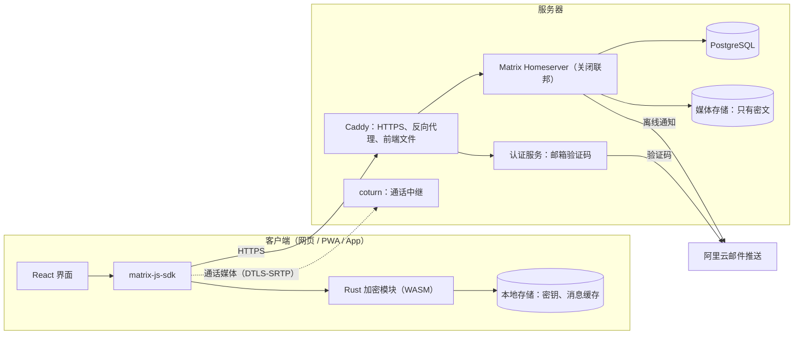
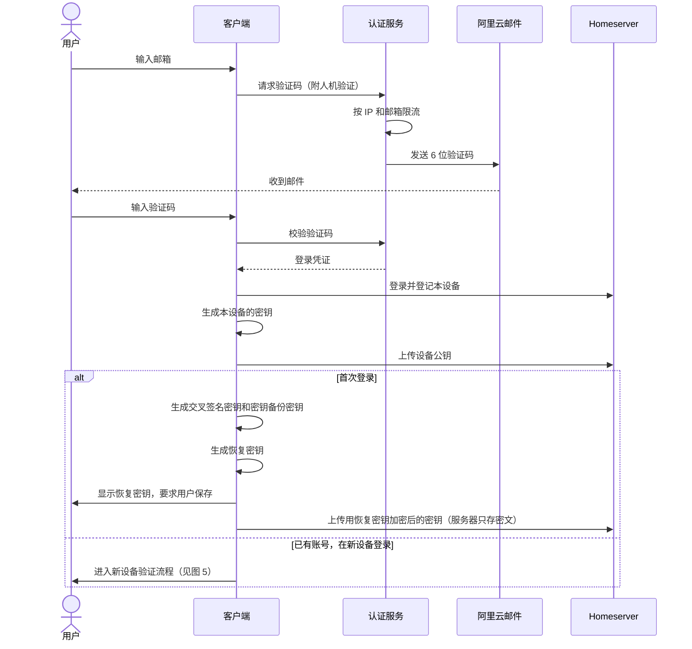
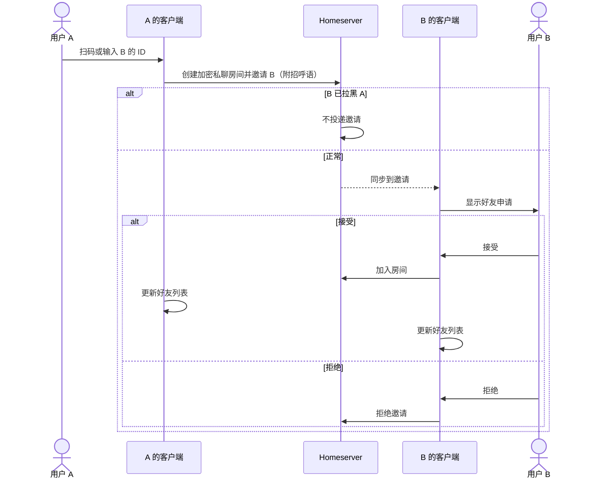
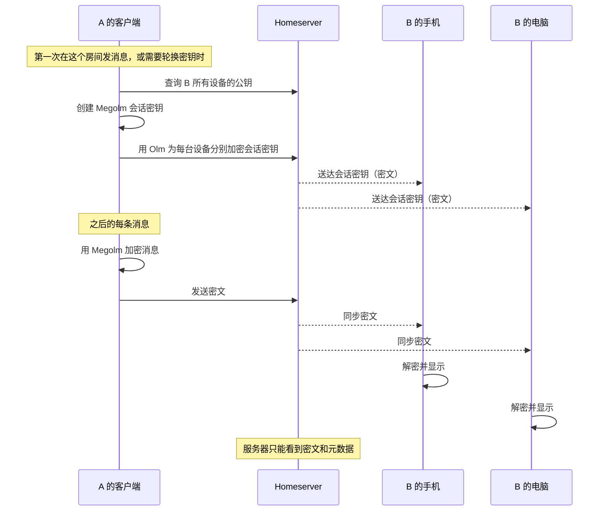
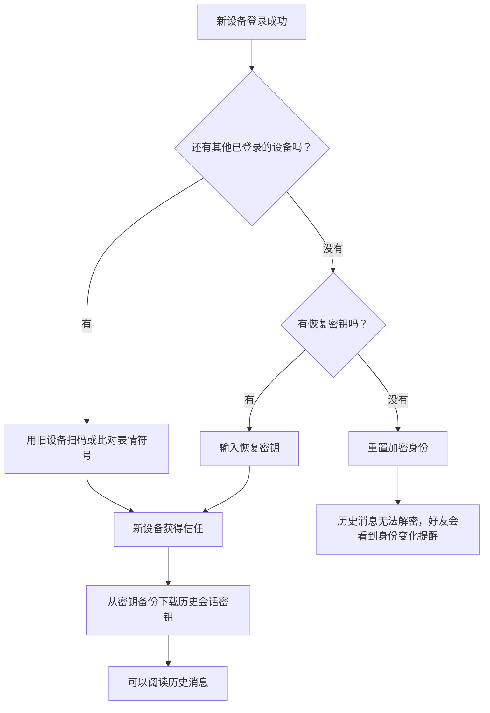
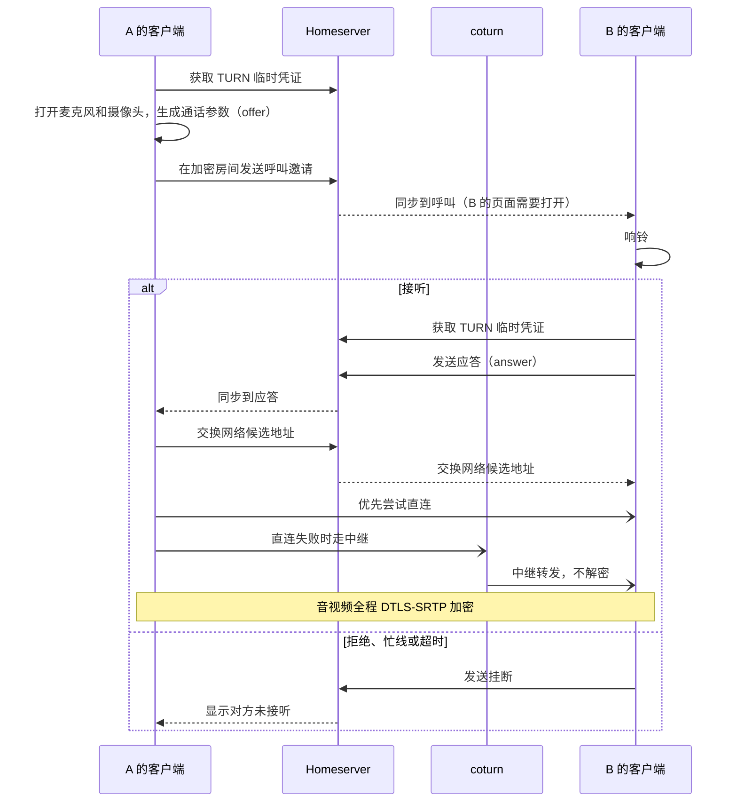
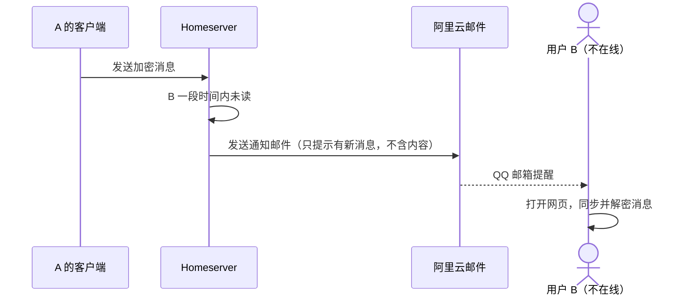
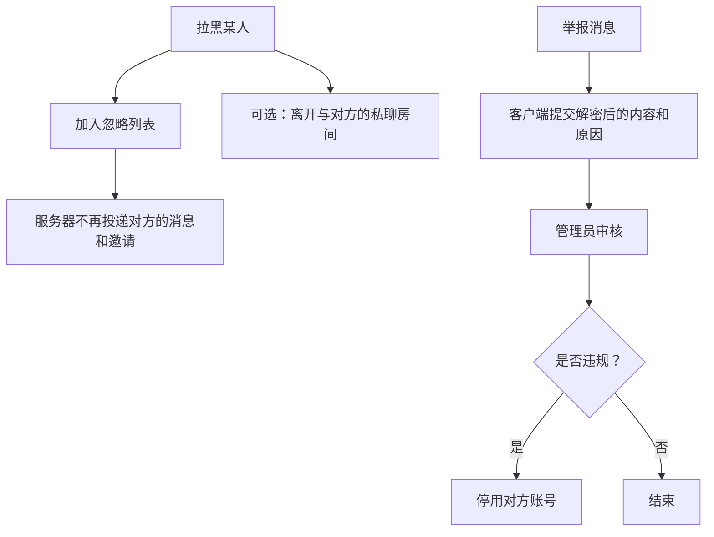

# 功能清单与逻辑示意图

本文档基于 [TECH_STACK.md](./TECH_STACK.md) 的 Matrix 方案编写。

阶段标记：

| 标记 | 含义 |
|------|------|
| **验证** | 验证阶段就要跑通（见 TECH_STACK.md 的"验证阶段"） |
| **1** | 第一版 |
| **2** | 第二阶段 |
| **3** | 后续 |

## 一、功能清单

### 1. 账号

| 功能 | 阶段 | 实现方式 | 说明 |
|------|------|---------|------|
| 邮箱验证码注册 / 登录 | 验证 | 认证服务（MAS 或自建）发送 6 位验证码，校验后登录 homeserver | 不用登录链接 |
| 人机验证与限流 | 1 | 认证服务按 IP 和邮箱限流 | 防止被用来轰炸邮箱 |
| 设置密码（可选） | 1 | 认证服务 | 避免每次登录都收邮件 |
| 退出登录 | 验证 | 注销当前设备 | |
| 设备管理 | 1 | 查看、重命名、移除已登录设备 | |
| 账号注销 | 1 | homeserver 停用账号并清除数据 | iOS 上架必需 |
| 短信绑定与找回 | 2 | 阿里云短信 | 签名通常需要企业资质 |

### 2. 加密与安全

| 功能 | 阶段 | 实现方式 | 说明 |
|------|------|---------|------|
| 首次登录生成恢复密钥 | 验证 | 初始化交叉签名和密钥备份 | 明确告知"丢失后历史消息无法恢复" |
| 新设备验证 | 验证 | 旧设备扫码或比对表情符号 | |
| 用恢复密钥恢复历史消息 | 验证 | 从服务端密钥备份恢复 | |
| 好友身份核对 | 1 | 用户验证（扫码或表情符号） | 防止中间人攻击 |
| 对方身份变化提醒 | 1 | 交叉签名身份变化时醒目提示 | |
| 未验证设备提醒 | 1 | | |
| 所有房间强制加密 | 验证 | 客户端只创建加密房间，服务端默认加密 | |
| 输入法安全提示 | 1 | 首次使用时提示关闭云输入 | 国内特有风险 |
| 阅后即焚 | 3 | 待设计 | |

### 3. 个人资料

| 功能 | 阶段 | 实现方式 | 说明 |
|------|------|---------|------|
| 昵称、头像 | 1 | Matrix 个人资料 | **服务器可见，不加密** |
| 账号 ID | 验证 | Matrix 用户 ID，由系统生成 | **不能用邮箱作为 ID**，否则会暴露邮箱 |
| 我的二维码 | 1 | 二维码内容为用户 ID | |
| 个性签名 | 2 | 待设计 | |

### 4. 好友（通讯录）

Matrix 没有"好友"的概念，用**加密私聊房间**来实现：发好友申请就是建一个私聊房间并邀请对方，对方加入即成为好友。

| 功能 | 阶段 | 实现方式 | 说明 |
|------|------|---------|------|
| 按 ID 搜索用户 | 1 | 用户目录搜索，只允许精确匹配 | 防止被批量枚举用户 |
| 扫码加好友 | 1 | 扫描对方二维码 | |
| 发送好友申请 | 验证 | 创建加密私聊房间并邀请对方 | 招呼语附在邀请里，**服务器可见** |
| 接受 / 拒绝申请 | 验证 | 加入房间 / 拒绝邀请 | |
| 好友列表 | 验证 | 私聊房间列表（`m.direct`） | |
| 删除好友 | 1 | 离开私聊房间 | |
| 备注名 | 1 | 账户数据 | 服务器可见，以后可改为加密存储 |
| 拉黑 / 解除拉黑 | 1 | 忽略列表（`m.ignored_user_list`） | 服务器不再投递对方的消息和邀请 |
| 好友分组 | 2 | 账户数据 | |
| 名片分享 | 2 | 自定义消息类型 | |

### 5. 会话列表

| 功能 | 阶段 | 实现方式 | 说明 |
|------|------|---------|------|
| 会话列表（预览、时间、未读数） | 验证 | 客户端解密后生成预览 | 服务器看不到预览内容 |
| 置顶 | 1 | 房间标签 | |
| 免打扰 | 1 | 推送规则 | |
| 不显示会话 | 1 | 本地隐藏 | |
| 清空聊天记录（仅自己） | 1 | 记录清空时间点，客户端隐藏之前的消息 | |
| 未读角标 | 1 | | |

### 6. 消息

| 功能 | 阶段 | 实现方式 | 说明 |
|------|------|---------|------|
| 文字 | 验证 | Megolm 加密 | |
| 离线消息补收 | 验证 | Matrix 同步接口 | |
| 图片 | 1 | 客户端用随机密钥加密后上传，密钥放在加密消息里 | 服务器只存密文 |
| 语音 | 1 | 同上 | |
| 表情 | 1 | Unicode 表情 | |
| 发送失败重试 | 1 | | |
| 已读回执 | 1 | 回执（可设为私密） | 服务器可见 |
| 正在输入 | 1 | 输入状态 | 服务器可见 |
| 撤回（2 分钟内） | 1 | 删除事件（redaction） | 时限由客户端控制 |
| 删除（仅自己） | 1 | 本地隐藏 | |
| 复制 | 1 | | |
| 转发 | 1 | 客户端解密后在目标房间重新加密发送 | |
| 引用回复 | 2 | 消息关联 | |
| 本地搜索 | 2 | 客户端对已解密消息建索引 | 服务器无法搜索 |

### 7. 通话

| 功能 | 阶段 | 实现方式 | 说明 |
|------|------|---------|------|
| 1 对 1 语音 / 视频 | 验证 | Matrix 通话，信令在加密房间内传递，经 coturn 中继 | 媒体端到端加密 |
| 来电界面：接听、拒绝、忙线、超时 | 1 | | 网页端只在页面打开时响铃 |
| 通话中：静音、关闭摄像头、切换摄像头、免提 | 1 | | |
| 通话记录（显示在聊天里） | 1 | | |
| 后台来电 | 2 | Capacitor 原生插件 | 仅 App |
| 群通话 | 3 | Element Call（MatrixRTC + LiveKit） | |

### 8. 通知

| 功能 | 阶段 | 实现方式 | 说明 |
|------|------|---------|------|
| 页面内提醒（声音、标题闪烁） | 1 | | |
| 邮件离线通知 | 1 | homeserver 内置邮件通知 | **不含消息内容** |
| 安卓推送 | 2 | 自建推送网关 → 极光或个推 | |
| iOS 推送 | 3 | 推送网关 → APNs | |

### 9. 举报与管理

| 功能 | 阶段 | 实现方式 | 说明 |
|------|------|---------|------|
| 举报用户 / 消息 | 1 | 用户主动提交解密后的内容和原因 | 服务器本身看不到内容 |
| 管理员审核与封禁 | 1 | homeserver 管理接口 | |
| 用户协议、隐私政策 | 1 | | 上架必需 |

### 10. 群聊（第二阶段）

协议本身已支持，界面在第二阶段做。

| 功能 | 阶段 | 实现方式 | 说明 |
|------|------|---------|------|
| 创建群聊 | 2 | 加密房间 | |
| 邀请 / 移除成员 | 2 | 邀请、踢出 | 成员变化时自动轮换密钥 |
| 群主 / 管理员 | 2 | 权限等级（群主 100、管理员 50） | |
| 禁言成员 | 2 | 权限等级 | |
| 邀请需管理员确认 | 2 | 权限等级 | |
| 群公告 | 2 | 置顶的加密消息 | 不用房间主题，主题不加密 |
| 群昵称 | 2 | 房间内昵称 | 服务器可见 |
| 转让群主、解散群聊 | 2 | | |

### 11. 商城与订单（第二阶段，独立业务后端）

| 功能 | 阶段 | 说明 |
|------|------|------|
| 店铺、商品管理 | 2 | |
| 商品卡片 | 2 | |
| 下单、改价、接单、发货、确认收货 | 2 | |
| 订单卡片、交易提醒 | 2 | 由业务后端的机器人账号发送 |
| 收款码 | 2 | 仅用于实物商品 |
| 系统消息、广播 | 2 | |
| 后台管理 | 2 | |

## 二、服务器能看到什么

端到端加密是核心卖点，必须清楚哪些数据加密了、哪些没有：

| 数据 | 服务器能否看到 |
|------|--------------|
| 消息内容、图片、语音 | **不能** |
| 通话的音视频 | **不能** |
| 群公告（用加密消息实现时） | **不能** |
| 谁和谁是好友、谁在哪个群 | 能 |
| 消息发送时间、数量、大小 | 能 |
| 昵称、头像 | 能 |
| 备注名、好友分组（存在账户数据里时） | 能 |
| 好友申请的招呼语 | 能 |
| 群名称、群昵称 | 能 |
| 已读回执、正在输入 | 能 |
| 通话的时间和时长 | 能 |
| 登录 IP、设备信息 | 能 |

隐私政策和产品说明里要如实写明这些。

## 三、逻辑示意图

### 图 1：系统架构

### 图 2：注册登录与首次设置密钥

### 图 3：添加好友

### 图 4：发送加密消息

以 A 给 B 发消息、B 有手机和电脑两台设备为例：

发送图片或语音时：客户端先用随机密钥加密文件并上传，再把文件地址和密钥放进一条加密消息里发送。

### 图 5：新设备登录与恢复历史消息

### 图 6：1 对 1 通话

### 图 7：离线邮件通知

### 图 8：拉黑与举报

